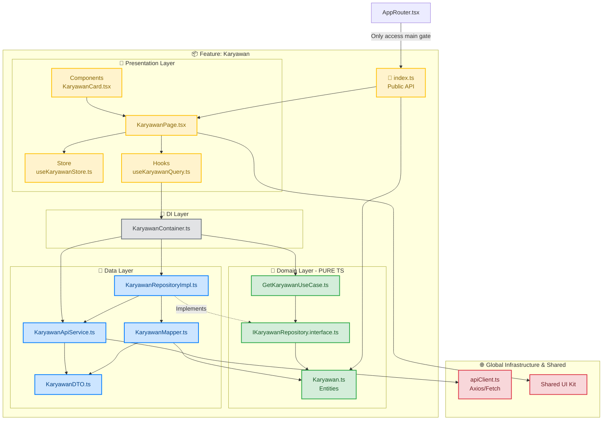

# HRIS Frontend

Starter template frontend HRIS berbasis React, TypeScript, dan Vite. Fitur baru mengikuti pola **Feature-Based Clean Architecture**: setiap fitur dipisahkan ke layer Domain, Data, Presentation, dan DI, dengan `index.ts` sebagai public API.

## Aturan Arsitektur

Gunakan tiga dokumen ini sebagai sumber aturan ketika menambah atau mengubah fitur:

1. [`folder-struktur.md`](./documentation/rules/domain-data-presentation/27%20Oktober%202026/folder-struktur.md) — struktur folder dan tanggung jawab setiap layer.
2. [`mermaid diagram.md`](./documentation/rules/domain-data-presentation/27%20Oktober%202026/mermaid%20diagram.md) — arah dependensi dan batas antarfitur.
3. [`rules.md`](./documentation/rules/domain-data-presentation/27%20Oktober%202026/rules.md) — detail implementasi Domain, Data, DI, Presentation, dan public API.

Jika contoh implementasi di tempat lain berbeda, ikuti aturan dan struktur pada dokumen-dokumen di atas untuk fitur baru.

## Ringkasan Perubahan Utama

- **Dependency Injection Layer (`di/`)**: Folder untuk merakit service, repository, dan use case secara terpusat.
- **Standardisasi Mapping Data (`DTO` & `Mapper`)**: DTO untuk data mentah, mapper untuk konversi ke entity Domain.
- **Modern State Management**: TanStack Query untuk server state, Zustand untuk local UI state.
- **Naming Convention**: camelCase untuk file store dan hooks, PascalCase untuk entity/DTO/mapper/service/repository/useCase.
- **Public API (`index.ts`)**: Satu-satunya point masuk untuk fitur, mencegah deep import.

## Teknologi

- React 19, TypeScript strict mode, dan Vite
- React Router untuk routing
- TanStack Query untuk state server
- Zustand untuk state UI lokal
- Tailwind CSS untuk styling
- Jest dan Testing Library untuk pengujian

## Menjalankan Project

Pastikan Node.js dan npm tersedia, lalu jalankan dari root repository:

```powershell
npm install
npm run dev
```

Vite akan menampilkan URL development server, biasanya `http://localhost:5173`.

Perintah project:

```powershell
npm test -- --runInBand
npm run lint
npm run format:check
npm run build
```

`npm run build` menjalankan type-check TypeScript dan production build Vite.

## Struktur Feature

Struktur feature mengikuti aturan project. Tidak semua folder wajib dibuat: tambahkan hanya bagian yang dibutuhkan.

```text
src/
├── features/
│   └── <feature>/
│       ├── index.ts                         # Public API fitur
│       ├── domain/
│       │   ├── entities/                    # Entity bisnis murni
│       │   ├── repositories/                # Kontrak repository
│       │   └── usecases/                    # Aturan bisnis
│       ├── data/
│       │   ├── dtos/                        # Bentuk data dari sumber data
│       │   ├── mappers/                     # DTO <-> entity
│       │   ├── services/                    # Akses API
│       │   └── repositories/                # Implementasi kontrak Domain
│       ├── presentation/
│       │   ├── components/                  # Komponen UI khusus fitur
│       │   ├── hooks/                       # TanStack Query, adapter UI
│       │   ├── pages/                       # Halaman fitur
│       │   └── store/                       # State UI lokal (Zustand)
│       ├── di/                              # DI Container, factory engine
│       └── __tests__/
├── components/
├── hooks/
├── stores/
├── routes/
│   └── AppRoutes.tsx
├── layout/
├── utils/
├── App.tsx
└── main.tsx
```

### Contoh Implementasi: Fitur Karyawan

Fitur demo di `src/features/karyawan` dapat dibuka dari `/karyawan-demo`.

## Tanggung Jawab Layer

### Domain

- Entity, kontrak repository, dan use case.
- TypeScript murni; tidak mengimpor React, TanStack Query, Zustand, Axios.
- Kontrak repository di `domain/repositories/`.
- Use case menerima kontrat repository lewat constructor.

### Data

- Service mengambil data dari API.
- DTO merepresentasikan format API; mapper mengubah ke entity Domain.
- Repository implementasi mengimplementasikan kontrat Domain.
- Data Layer boleh bergantung pada Domain.

### DI (`di/`)

- Merakit service, repository, use case.
- Presentation tidak membuat repository secara langsung.

### Presentation

- Page dan komponen untuk tampilan pengguna.
- Hook menghubungkan UI dengan use case; gunakan TanStack Query, Zustand hanya bila perlu.
- Tidak mengakses service, DTO, mapper, repository implementasi langsung.

### Public API (`index.ts`)

- Ekspor halaman/entry point fitur.
- File luar hanya mengimpor dari `@/features/<feature>`.
- Jangan mengekspor detail internal tanpa kebutuhan.

## Arah Dependensi



## Batas Antarfitur

- Fitur lain hanya mengakses public API melalui `src/features/<feature>/index.ts`.
- Jangan melakukan deep import ke `domain/`, `data/`, `di/`, atau `presentation/` fitur lain.
- Untuk UI, hook, type, atau utilitas yang digunakan bersama, gunakan folder lintas fitur atau shared layer.

## Konvensi

- Nama folder feature: lowercase dengan dash (`employee-benefits`).
- PascalCase untuk file entity, DTO, mapper, service, repository, use case, page, komponen.
- Hook ikuti pola React `use...`, contoh: `useKaryawanQuery.ts`.
- Beri tipe pada kontrak dan data; hindari `any`.
- Pertahankan error agar terlihat oleh UI.
- Hindari store bila state hanya dipakai satu komponen.

## Pengujian

Tempatkan pengujian di `__tests__/` sesuai layer:

- `domain/`: UseCase dan aturan bisnis (gunakan mock repository).
- `data/`: Mapper dan integrasi repository/service.
- `presentation/`: Halaman/komponen, loading, error, interaksi.

Jalankan pengujian:

```powershell
npm test -- --runInBand src/features/karyawan/__tests__
npx eslint src/features/karyawan
npm run build
```

## Catatan Repository

- `src/features/landing` dan `src/features/auth` menggunakan pola repository lama. Gunakan `src/features/karyawan` sebagai contoh untuk fitur baru.
- `src/_reference_ui/` adalah katalog UI referensi; dapat diakses melalui `/reference-ui`.
- Implementasi autentikasi dan route terlindungi tetap ada pada fitur yang sudah ada.