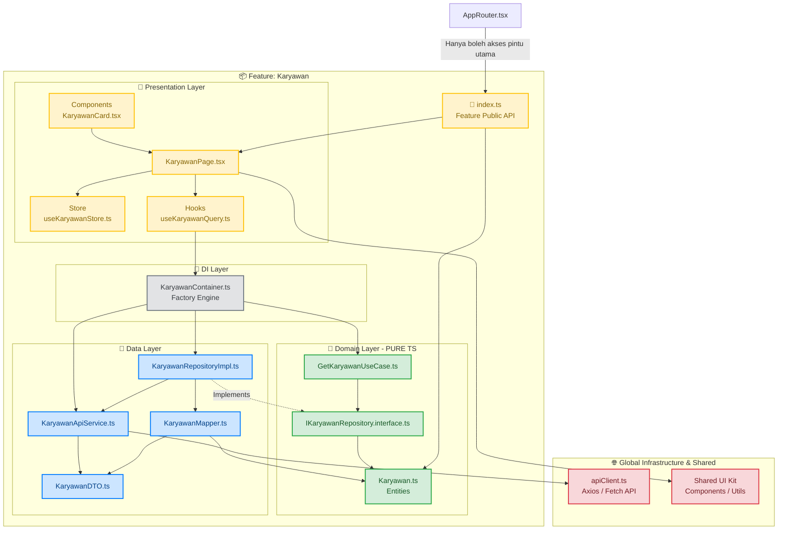
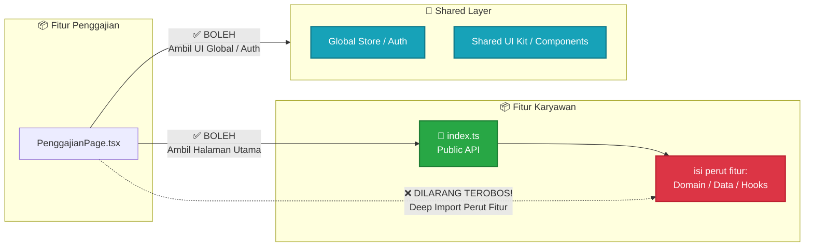

Berikut adalah gambaran arsitektur **Feature-Based Clean Architecture** front-end yang telah kita bahas. Diagram ini menunjukkan bagaimana struktur folder disusun, bagaimana arah dependensi mengalir (hanya boleh masuk ke dalam/Domain), serta bagaimana **DI Layer** dan **Public API (`index.ts`)** menjaga pembatasan kode.

📐 1. Diagram Aliran Data & Hubungan Antar-Layer (Satu Fitur)

Diagram ini menggambarkan bagaimana sebuah fitur (misal: `karyawan`) bekerja di dalamnya. Perhatikan bahwa **Domain Layer berada di tengah dan bersifat suci (tidak punya dependensi ke luar)**.

mermaid

Gunakan kode dengan hati-hati.

---

🧱 2. Diagram Komunikasi Antar-Fitur (Cross-Feature Boundaries)

Diagram ini menunjukkan bagaimana **Feature Public API (`index.ts`)** dan folder **Shared** bertindak sebagai benteng perlindungan agar Fitur A dan Fitur B tidak mengalami _tight coupling_ (saling keterikatan yang berantakan).

mermaid

Gunakan kode dengan hati-hati.

🔍 Cara Membaca Diagram:

1. **Paling Suci (Hijau/Domain):** Kotak hijau di tengah tidak memiliki panah keluar menuju layer data atau presentation. Dia terisolasi sempurna dan hanya menerima perintah.
2. **Pabrik Perakitan (Abu-abu/DI):** Menjadi satu-satunya area yang boleh menyentuh Domain dan Data sekaligus untuk merakit fungsi (UseCase) sebelum diberikan ke Presentation Layer.
3. **Pintu Gerbang (Pintu Cokelat/Public API):** Pihak luar seperti `AppRouter` dilarang keras mengintip kotak merah (`Private_Code`). Semua akses wajib melalui `index.ts` (Pintu Hijau).

---

💡 **Tip Tambahan untuk Hindari Over-Engineering**

• **Zustand Hook Naming**: Pastikan penamaan file store di `presentation/store/` tetap konsisten menggunakan **camelCase** (misal: `useKaryawanStore.ts`). Ekspor hook dengan nama yang sama agar selaras dengan ekosistem React.

Apakah Anda ingin saya buatkan **contoh file tiruan (Mock Repository)** di dalam arsitektur ini agar Anda bisa melihat bagaimana DI Layer secara instan menukar data API menjadi data lokal saat melakukan **Unit Testing**?